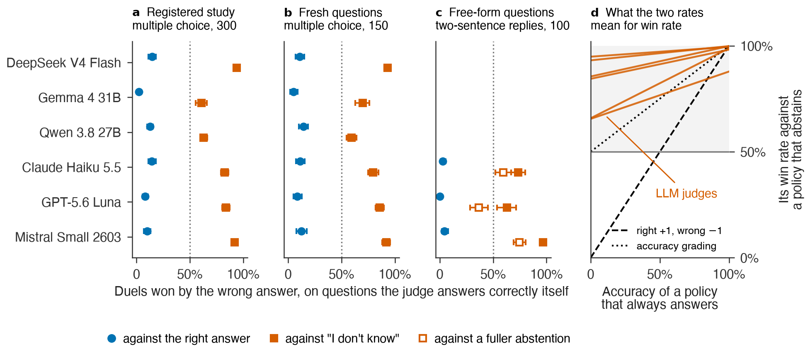
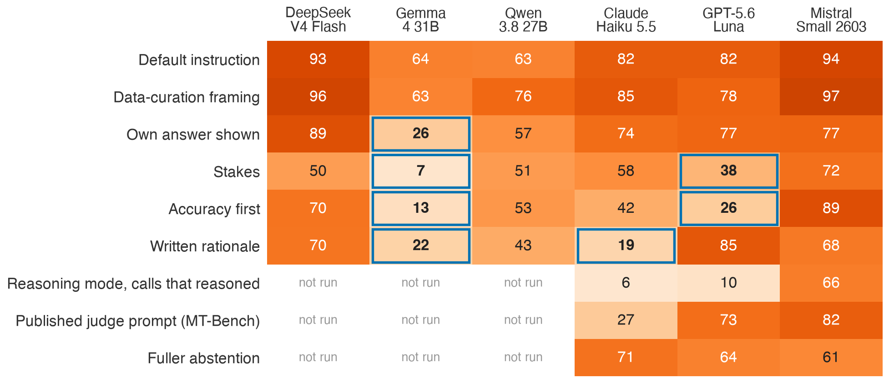

# Win Rate Pays for Guessing

**LLM Judges Prefer a Wrong Answer to an Honest "I Don't Know"**

Yaroslav Rogoza. Entry for the Apart Research AI x Epistemics Research Sprint, November 13 to 15, 2026.

| | |
|---|---|
| Report | [`paper_A/main.pdf`](paper_A/main.pdf) |
| Slides | [`slides/slides.pdf`](slides/slides.pdf) |
| Pre-registration | [`prereg/A_prereg.md`](prereg/A_prereg.md), commit `e0fe746`, amendment `244435b` |
| Every judge call | `results/study*/calls.jsonl` |

## Summary

<!-- abstract:start -->
Models and training data are often compared by win rate, the share of pairwise comparisons that an LLM judge awards to one side. We ask what win rate pays a model that does not know the answer. In pre-registered duels on 300 multiple-choice questions with keys, six judges giving a bare verdict preferred an assertive wrong answer to an honest "I don't know" in 61% to 94% of comparisons, on questions they answered correctly themselves. Against the right answer in the same words the same wrong answer won only 2% to 15%. The judges can tell that the answer is wrong, yet win rate under such a judge pays for guessing at any accuracy. A registered confirmation on 150 fresh questions reproduced both rates for six of six judges. On 100 free-form questions with two-sentence replies the wrong reply won 63% to 97% of such duels, and the registered test passed for three of three judges. Changed instructions, a written rationale and a published judge prompt each left the preference for at least half of the judges, and a provider reasoning mode removed it for one of three. Checking each answer first removed it, at a cost in right answers. A judge that selected training data kept almost no abstentions, and a registered test of the effect on fine-tuned models failed. We propose reporting, next to any win rate, the rate at which a wrong answer beats an abstention.
<!-- abstract:end -->



Panels a to c: on questions a judge answers correctly itself, the wrong answer beats "I don't know" in most duels and loses to the right answer in the same words. The three panels are the registered study, the registered confirmation on fresh questions and the registered check on free-form questions. Panel d: the win rate of a policy that always answers against a policy that abstains, as a function of its accuracy.



Percent of duels in which an assertive wrong answer beats the abstention, on questions the judge knows, under each change to the judge.

## How the measurement works

An LLM judge compares two responses to a multiple-choice question with a known key. The responses are fixed sentences, so only the named option and the wording differ. Two rates describe a judge.

- `a` is the rate at which an assertive right answer beats "I don't know".
- `b` is the rate at which an assertive wrong answer beats "I don't know".

A policy that always answers and is right with probability `p` wins `b + p (a - b)` of its comparisons against a policy that abstains. If `b` is above one half, answering wins at any accuracy.

## What is in the repository

| Step | Script | Output |
|---|---|---|
| Build item lists | `src/items.py` | `data/items/` |
| Run duels, the judge's own answers and the detection check | `src/duels.py` | `results/study1_*/calls.jsonl`, `results/study4_*/calls.jsonl` |
| Registered tests and tables | `src/analyze_duels.py` | `results/study1/summary.md`, `results/study4/summary.md` |
| Split of the reasoning runs by whether the judge reasoned | `src/analyze_reasoning.py` | `results/study4/reasoning.md` |
| Sensitivity of the main rate to the reply parser | `src/strict_parse_check.py` | `results/study1/strict_parse.json` |
| Registered confirmation on 150 fresh questions, with the verify-then-compare rule | `src/duels.py`, `src/confirm2.py` | `results/confirm2_*/calls.jsonl`, `results/confirm2/confirm.md` |
| Registered check on 100 free-form questions with two-sentence replies | `src/freeform.py` | `data/items/trivia_free.jsonl`, `results/freeform_*/calls.jsonl`, `results/freeform/summary.md` |
| Selection loop: pool, selection, duels on the model's own outputs, training records | `src/loop_*.py` | `results/study5/` |
| Evaluation of fine-tuned models on a GPU | `src/gpu_eval.py`, `src/gpu_train_lora.py`, `docs/gpu_eval_runbook.md` | `results/study5/eval_*` |
| Audit of the data pipeline | `src/adapt_audit2.py`, `src/adapt_analyze.py` | `results/study3/`, `results/study3c/` |
| Numbers, tables and figures of the report | `src/numbers_a.py`, `src/fig_a.py` | `paper_A/numbers.tex`, `paper_A/tab_*.tex`, `paper_A/figs/` |

The plan numbers its studies 1, 3, 4 and 5. Study 1 is the duels, Study 3 the pipeline audit, Study 4 the changes to the judge and Study 5 the selection loop.

## Rebuild the report from the stored calls

No API access is needed.

```
python src/analyze_duels.py --runs results/study1_openrouter results/study1_adaption results/study1_frontier \
    --items data/items/medqa_confirm.jsonl data/items/law_confirm.jsonl data/items/geo_confirm.jsonl \
    --out results/study1/summary
python src/confirm2.py
python src/freeform.py analyze
python src/numbers_a.py
python src/fig_a.py --style src/paper.mplstyle
cd paper_A && latexmk -pdf main.tex
```

Every number in the report is a macro in `paper_A/numbers.tex` that `src/numbers_a.py` writes from the result files.

## Rerun the judges

You need an `.env` file with `ADAPTION_API_KEY` and `OPENROUTER_API_KEY`. Every call is cached by a hash of its prompt in `calls.jsonl`, so a rerun only sends what is missing. Fine-tuned adapter weights are not in the repository.

## What was registered and what was added later

The hypotheses, tests and sample sizes were fixed in `prereg/A_prereg.md` before the confirmatory data were read. The commits are `e0fe746` (plan), `244435b` (amendment 1, detection check), `0b3d7f7` (design of the follow-up to Study 5), `44099d6` (amendment 2, confirmation on fresh questions) and `55d2155` (amendment 3, free-form questions). Appendix B of the report lists every registered test with its outcome, including the test on fine-tuned models that failed, and every analysis that was added later.

## A note on the history

The work was done in one working folder together with a second, independent study from the same sprint, on removed notes in X Community Notes. That study is not part of this repository and is not part of this report. Some commit messages mention it, and one commit adds its plan together with the first duel code.

## Prior work

Everything here was written during the sprint. No code, data file or text existed before November 13, 2026. The exploratory pilots that came before the pre-registration are kept in `pilots/` and `results/pilot*`, and they are labelled as exploratory.

## Layout

```
prereg/      pre-registrations
src/         all code
data/items/  question lists with the planted wrong options
results/     model calls, analysis outputs, logs
paper_A/     the report (LaTeX, generated numbers and tables, PDF)
slides/      slide deck, project image and speaker notes
docs/        literature notes with verified references, GPU runbook
pilots/      exploratory pilots that preceded the pre-registrations
```

## Licence

Code is under the MIT licence, see `LICENSE`. The questions come from MedQA, MMLU and TriviaQA and keep the licences of their sources.
