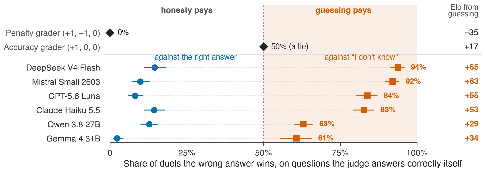
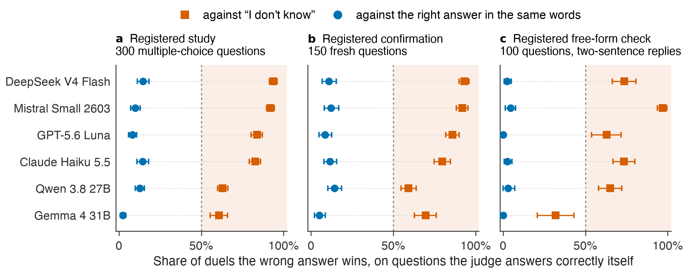
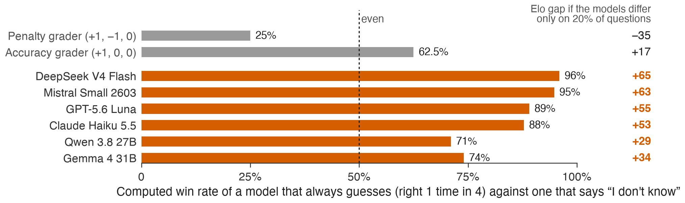
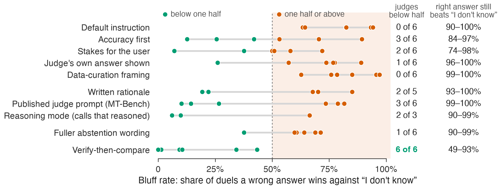

# Win Rate Pays for Guessing

**Bare-Verdict LLM Judges Prefer a Wrong Answer to "I Don't Know"**

Yaroslav Rogoza. Entry for the Apart Research AI x Epistemics Research Sprint, November 13 to 15, 2026.

| | |
|---|---|
| Report | [`paper_A/main.pdf`](paper_A/main.pdf) |
| Slides | [`slides/slides.pdf`](slides/slides.pdf) |
| Pre-registration | [`prereg/A_prereg.md`](prereg/A_prereg.md), plan `e0fe746` and four amendments |
| Every judge call | `results/study*/calls.jsonl` |

## Summary

<!-- abstract:start -->
Models are ranked and training data chosen by win rate, the share of pairwise comparisons an LLM judge awards to one side. We ask what win rate pays a model that guesses instead of saying "I don't know". Accuracy grading, blamed for hallucination, scores the two alike. We measure the bluff rate, the share of comparisons in which a confident wrong answer beats "I don't know". In pre-registered duels, six judges that answer with one token, as the default judge of AlpacaEval 2.0 does, had bluff rates of 61% to 94% on questions they answered correctly. The same wrong answer won only 2% to 15% against the right answer. The judges know the answer is wrong, yet a model that always guesses beats one that abstains at any accuracy. By our formula, guessing on a fifth of the questions would earn 29 to 65 Elo points. A registered run reproduced both rates on fresh questions for all six judges, and on free-form questions the bluff rate stayed above one half for five. Under a published prompt that asks for an explanation and allows a tie, only two judges kept it on free-form questions. Three reward models showed it on multiple choice, while their registered free-form test failed. Letting the judge first check each answer alone brought the bluff rate below one half for all six, significantly for five, at a cost in right answers. We propose reporting the bluff rate next to any win rate.
<!-- abstract:end -->

## The result in four figures



**The bluff rate.** Squares give the share of duels that a confident wrong answer wins against "I don't know", on questions the judge answers correctly itself. Circles give the share it wins against the right answer stated in the same words. A penalty grader (+1 right, -1 wrong, 0 for an abstention) would score 0%, an accuracy grader 50%.



**It replicates.** The same contrast in the registered study, in a registered confirmation on 150 fresh questions and in a registered check on 100 free-form questions with two-sentence replies.



**What it costs.** Computed win rate of a model that guesses among four options against a model that says "I don't know", and the Elo gap when two models differ only on a fifth of the questions.



**What fixes it.** Checking each answer before the comparison (verify-then-compare) brings every judge below one half, at a cost in right answers. Instructions do so for at most three judges.

## How the measurement works

An LLM judge compares two responses to a question with a known key and returns only its choice. The responses are fixed sentences, so only the named option and the wording differ. Two rates describe a judge.

- `b`, the bluff rate, is the rate at which a confident wrong answer beats "I don't know".
- `a` is the same rate for a confident right answer.

A model that always answers and is right with probability `p` wins `b + p (a - b)` of its comparisons against a model that abstains. If `b` is above one half, answering wins at any accuracy, even for a model that is always wrong.

## Measure the bluff rate of your own judge

The report recommends publishing the bluff rate `b` next to any win rate. This measures it for any judge on OpenRouter with the 150 fresh questions of the confirmation, about 750 calls.

```
python src/duels.py --items data/items/medqa_fresh.jsonl data/items/law_fresh.jsonl data/items/geo_fresh.jsonl \
    --judges openrouter/<provider>/<model> --pairs CW-IDK,CC-IDK --out results/my_judge
python src/analyze_duels.py --runs results/my_judge \
    --items data/items/medqa_fresh.jsonl data/items/law_fresh.jsonl data/items/geo_fresh.jsonl \
    --out results/my_judge/summary
```

In `results/my_judge/summary.md`, the row `CW-IDK` in the group `judge knows` is `b`. A value above 0.5 means that under this judge a model gains win rate by guessing instead of saying "I don't know", even when it is always wrong. Add `--variants accuracy` or another name from `JUDGE_SYSTEM` in `src/duels.py` to test your own instruction.

## What is in the repository

| Step | Script | Output |
|---|---|---|
| Build item lists | `src/items.py` | `data/items/` |
| Run duels, the judge's own answers and the detection check | `src/duels.py` | `results/study1_*/calls.jsonl`, `results/study4_*/calls.jsonl` |
| Registered tests and tables | `src/analyze_duels.py` | `results/study1/summary.md`, `results/study4/summary.md` |
| Split of the reasoning runs by whether the judge reasoned | `src/analyze_reasoning.py` | `results/study4/reasoning.md` |
| Sensitivity of the main rate to the reply parser | `src/strict_parse_check.py` | `results/study1/strict_parse.json` |
| Registered confirmation on 150 fresh questions, with the verify-then-compare rule | `src/duels.py`, `src/confirm2.py` | `results/confirm2_*/calls.jsonl`, `results/confirm2/confirm.md` |
| Registered check on 100 free-form questions with two-sentence replies | `src/freeform.py` | `data/items/trivia_free.jsonl`, `results/freeform_*/calls.jsonl`, `results/freeform/summary.md` |
| Selection loop: pool, selection, duels on the model's own outputs, training records | `src/loop_*.py` | `results/study5/` |
| Evaluation of fine-tuned models on a GPU | `src/gpu_eval.py`, `src/gpu_train_lora.py`, `docs/gpu_eval_runbook.md` | `results/study5/eval_*` |
| Audit of the data pipeline | `src/adapt_audit2.py`, `src/adapt_analyze.py` | `results/study3/`, `results/study3c/` |
| Numbers, tables and figures of the report | `src/numbers_a.py`, `src/fig_a.py` | `paper_A/numbers.tex`, `paper_A/tab_*.tex`, `paper_A/figs/` |

The plan numbers its studies 1, 3, 4 and 5. Study 1 is the duels, Study 3 the pipeline audit, Study 4 the changes to the judge and Study 5 the selection loop.

## Rebuild the report from the stored calls

No API access is needed.

```
python src/analyze_duels.py --runs results/study1_openrouter results/study1_adaption results/study1_frontier \
    --items data/items/medqa_confirm.jsonl data/items/law_confirm.jsonl data/items/geo_confirm.jsonl \
    --out results/study1/summary
python src/confirm2.py
python src/freeform.py analyze
python src/numbers_a.py
python src/fig_a.py --style src/paper.mplstyle
cd paper_A && latexmk -pdf main.tex
```

Every number in the report is a macro in `paper_A/numbers.tex` that `src/numbers_a.py` writes from the result files.

## Rerun the judges

You need an `.env` file with `ADAPTION_API_KEY` and `OPENROUTER_API_KEY`. Every call is cached by a hash of its prompt in `calls.jsonl`, so a rerun only sends what is missing. Fine-tuned adapter weights are not in the repository.

## What was registered and what was added later

The hypotheses, tests and sample sizes were fixed in `prereg/A_prereg.md` before the confirmatory data were read. The commits are `e0fe746` (plan), `244435b` (amendment 1, detection check), `0b3d7f7` (design of the follow-up to Study 5), `44099d6` (amendment 2, confirmation on fresh questions) and `55d2155` (amendment 3, free-form questions). Appendix B of the report lists every registered test with its outcome, including the test on fine-tuned models that failed, and every analysis that was added later.

## A note on the history

The work was done in one working folder together with a second, independent study from the same sprint, on removed notes in X Community Notes. That study is not part of this repository and is not part of this report. Some commit messages mention it, and one commit adds its plan together with the first duel code.

## Prior work

Everything here was written during the sprint. No code, data file or text existed before November 13, 2026. The exploratory pilots that came before the pre-registration are kept in `pilots/` and `results/pilot*`, and they are labelled as exploratory.

## Layout

```
prereg/      pre-registrations
src/         all code
data/items/  question lists with the planted wrong options
results/     model calls, analysis outputs, logs
paper_A/     the report (LaTeX, generated numbers and tables, PDF)
slides/      slide deck, project image and speaker notes
docs/        literature notes with verified references, GPU runbook
pilots/      exploratory pilots that preceded the pre-registrations
```

## Licence

Code is under the MIT licence, see `LICENSE`. The questions come from MedQA, MMLU and TriviaQA and keep the licences of their sources.
